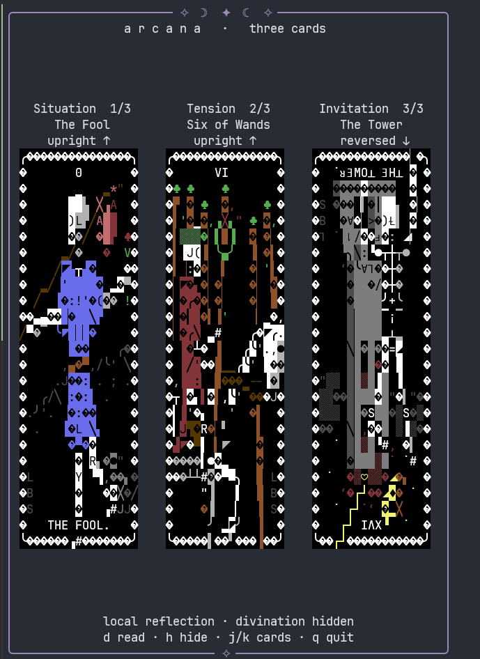
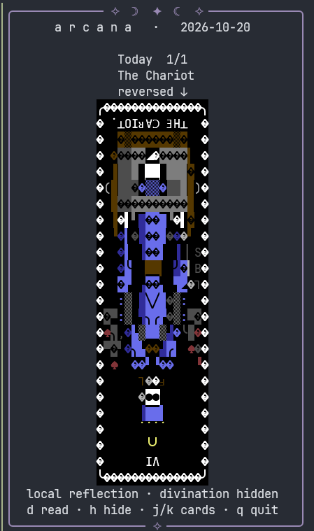
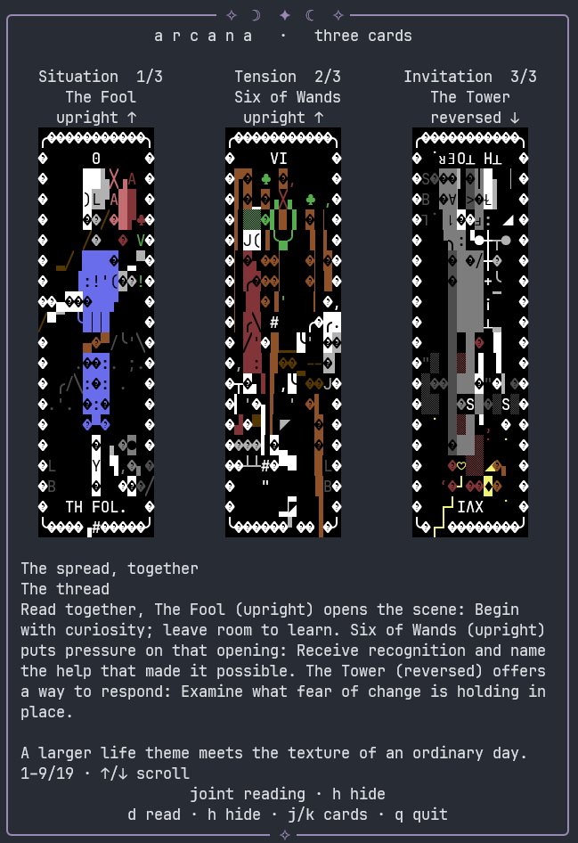

<div align="center">

# ✧ terminal tarot ✧

**A small ritual, held open in your terminal.**

One card for the day. Three for a question. A quiet place among your panes.

[](https://github.com/vlrie/terminal-tarot/actions/workflows/check.yml)
[](pyproject.toml)
[](LICENSE)

</div>

**Arcana** is a small tarot app that lives in a terminal or tmux pane. Its cards come from [arttime](https://github.com/poetaman/arttime); its moon-and-star frame follows your pane as you resize it. Leave a draw beside your work, then reveal a reading when you have a moment to listen.

<p align="center">
  
</p>

*The Fool · Six of Wands · The Tower, reversed. A real terminal screenshot; readings start hidden.*

## What it does

| Feature | A little more detail |
| --- | --- |
| **Card of the day** | A locally saved daily draw, stable when you reopen it. |
| **Three-card spreads** | Situation → Tension → Invitation, drawn without replacement. |
| **A word for the ritual** | Enter an optional seed word without echo. The word stays in memory and never reaches an AI provider. |
| **All 78 cards** | Major and minor arcana, with a major-only option. |
| **Real reversals** | Rotated illustrations, upright external labels, and orientation-specific meanings. |
| **A pane to live beside** | Persistent display, centered cards, responsive artwork, and a resizing mystical frame. |
| **Readings with a thread** | One connected interpretation, a small optional ritual, and a question to carry. |
| **Your choice of voice** | Offline reflections, or background requests to Claude Code, Codex CLI, or another configured CLI. |
| **Privacy at a keystroke** | Reveal/hide with `d`, hide immediately with `h`, or use artwork-only `--private` mode. |
| **Small by design** | Python standard library only at runtime. No account, database, daemon, or web server. |

## Begin

Requires **Python 3.12+**, [uv](https://docs.astral.sh/uv/), and Linux. Install [arttime](https://github.com/poetaman/arttime#installation) for the illustrated deck. Without it, Arcana still works with named cards and original reflections.

```sh
git clone https://github.com/vlrie/terminal-tarot.git
cd terminal-tarot
uv tool install .

arcana 1
```

Or run `./arcana 1` directly from the checkout without installing the package. That launcher uses `uv`; it downloads no runtime dependencies.

Use a UTF-8 terminal with truecolor and Unicode Symbols for Legacy Computing support. A dark background suits the deck. If your arttime installation is elsewhere:

```sh
arcana 3 --art-dir /path/to/arttime/textart
```

## Make a little space

```sh
arcana 1                         # today's card, held open
arcana 1 --ritual                # privately enter a word for today's draw
arcana 3                         # situation · tension · invitation
arcana 3 --ritual                # a repeatable word-seeded spread
arcana 3 --major                 # only the 22 major arcana
arcana 1 --upright-only          # omit reversals
arcana 1 --private               # artwork only; no provider or reveal
arcana 1 --once                  # print the draw and leave
arcana 3 --json                  # public card data for scripts
```

The same word and deck version reproduce the same spread. Single-card seeded draws include the date; three-card seeded spreads do not. An empty ritual input lets chance choose. Unseeded daily draws remain stable that day; unseeded three-card spreads are fresh each time.

Open a tmux split, run Arcana, and leave it there. It never rearranges your panes or silently replaces a card at midnight. Artwork shrinks to fit and returns to its original detail on expansion. Readings move beside the spread in wide panes and below it in narrower ones.

<details>
<summary>Card of the day</summary>



*One card, with room around it.*

*The Chariot, reversed, on 2026-10-20. The border and illustration follow the pane size.*

</details>

| Key | Action |
| --- | --- |
| `d` | Reveal or hide the reading |
| `h` | Hide private text immediately |
| `j` / `k`, `→` / `←` | Browse cards when the pane is very narrow |
| `↑` / `↓` | Scroll a revealed reading |
| `r` | Retry the reading for the same cards |
| `n` | Draw again, respecting daily and seeded rules |
| `q`, Ctrl-C | Quit and cancel any background request |

## Give the cards a voice

No AI is needed. Press `d` for an offline reflection with card-specific upright/reversed meanings. Three-card readings connect the spread as a whole, including its shared suits and contrasts.



*Press `d` to reveal the joined reading; scroll with `↑` / `↓` to reach the ritual and question. This screenshot shows the built-in offline reflection.*

To use an already authenticated CLI:

```sh
arcana 1 --provider claude
arcana 3 --ritual --provider codex
arcana 3 --provider claude --question   # privately prompt for a question
arcana 1 --once --interpret            # explicitly print an offline reflection
```

The cards appear first. The request runs in the background and its answer stays hidden. Resizing, browsing, and toggling visibility never request another reading. If the provider fails, your cards and offline reflection remain available. AI prose may vary even when the draw is reproducible.

Providers receive the cards, positions, orientations, original reflection prompts, and any question you explicitly enter. **They never receive the seed word.** A locally invoked CLI may use a remote model service.

## Keep it yours

- `--private` never starts a provider and disables revealing interpretation.
- Words, questions, and readings are not saved by Arcana. Hidden readings are not printed before reveal.
- Hiding cannot retract screenshots, tmux capture history, or recordings of previously revealed text.
- Daily state contains a random install identity and public card draws, stored locally with user-only permissions.
- `--no-color` keeps the frame and artwork monochrome.

<details>
<summary>Configuration and other CLI providers</summary>

On Linux, use `~/.config/arcana/config.toml` (respects `XDG_CONFIG_HOME`), or pass `--config PATH`. CLI flags take precedence.

```toml
provider = "claude"       # none, claude, codex, custom
# art_dir = "/path/to/arttime/textart"
# timezone = "Asia/Dubai"
timeout = 45
```

For another CLI, supply an argument array:

```toml
provider = "custom"
argv = ["my-reading-cli", "--plain"]
timeout = 60
```

The command reads a UTF-8 prompt from stdin and writes the answer to stdout. It runs in an empty temporary directory. Use absolute paths for scripts outside `PATH`. Custom commands are trusted configuration and are responsible for their own tools, records, and privacy.

The named adapters were checked against Claude Code 2.1.302 and Codex CLI 0.163.0 help. Claude uses tools disabled, safe mode, no MCP servers, and no session persistence. Codex uses an ephemeral read-only session with user config/rules skipped, web search disabled, and the shell-tool feature disabled. These settings constrain agent behavior; they are not an OS sandbox for the provider itself. Live authenticated responses depend on your CLI version and account.

Linux state defaults to `~/.local/share/arcana/` (respects `XDG_DATA_HOME`). Override it with `--data-dir PATH`. `--date YYYY-MM-DD` and `--timezone IANA/Zone` make the daily identity explicit.

macOS paths and POSIX terminal handling are implemented, but macOS still needs an on-device smoke test. Windows is unsupported.

</details>

## Development

```sh
PYTHONPATH=src uv run --no-project python -m unittest discover -s tests -v
uv build
```

The suite covers deterministic draws, concurrent daily state, all locally available artwork, resizing and centering, privacy, hidden input, provider failure/cancellation, and actual terminal interaction through pseudo-terminals. Runtime dependencies: none.

[Specification](docs/SPEC.md) · [Architecture](docs/ARCHITECTURE.md) · [Verification](docs/VERIFICATION.md) · [Screenshot notes](docs/screenshots/README.md)

## Thanks, arttime

Arcana starts with admiration for **[arttime](https://github.com/poetaman/arttime)**, authored and maintained by **Aman Mehra**, and the individual artists whose work it collects. Its tarot collection gives this little ritual its visual life. Arcana is an independent companion and does not claim affiliation or endorsement.

The original Arcana code and prose use the [MIT license](LICENSE). The deck is loaded from an existing arttime installation; upstream code and deck files are not bundled. Screenshots show selected upstream artwork for this personal, noncommercial project; those illustrations retain their own rights and are excluded from Arcana's MIT grant. See [credits, artwork terms, and preserved notices](CREDITS.md).

> A card is an invitation to notice. The interpretation leaves room for your own answer.
